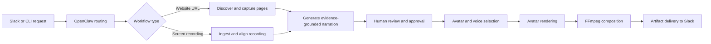

# OpenClaw Agentic URL Explainer & Screen-Recording Avatar Video Automation Pipeline

> **Public portfolio showcase — client-confidential project**
>
> This repository intentionally contains only a small, non-sensitive selection of files. The complete implementation was developed for a client and remains confidential. Production source code, prompts, workflow rules, tests, credentials, infrastructure configuration, media, and client data are not published.

## Project overview

This project is an agent-driven video production system built around OpenClaw. It turns either a website URL or an existing screen recording into an AI-presented explainer video, while keeping a human reviewer in control of page selection, narration, avatar choice, and final rendering.

The system combines workflow orchestration, website extraction, browser automation, transcript processing, LLM-assisted scripting, avatar-video APIs, FFmpeg compositing, Slack interactions, and resumable local state.

## What the complete system demonstrates

- **Agentic orchestration:** multi-stage workflows with explicit state transitions, resumability, and duplicate-request protection.
- **Human-in-the-loop controls:** approval gates for discovered pages, scripts, avatars, voices, and screen-video introductions.
- **Grounded content generation:** narration built from captured page evidence rather than generic marketing copy.
- **Multimodal processing:** website content, browser recordings, transcripts, audio, avatar video, and final MP4 composition.
- **External integrations:** OpenClaw, Slack, OpenAI-compatible models, HeyGen, Playwright, FFmpeg, and yt-dlp.
- **Failure-aware design:** graceful fallbacks, structured status payloads, retry controls, and persisted intermediate artifacts.
- **Delivery automation:** progress updates and completed videos returned to the originating Slack thread.

## Two production workflows

### 1. URL-based explainer video

1. Receive a URL and creative brief through Slack or CLI.
2. Discover relevant pages and capture browser evidence.
3. Let the reviewer approve the page set.
4. Generate and refine an evidence-grounded narration script.
5. Let the reviewer approve or edit the script.
6. Present avatar and voice choices.
7. Render the presenter, record B-roll, and composite the final video.
8. Deliver the MP4 and status summary back to the original thread.

### 2. Screen-recording avatar video

1. Ingest and normalize a local or remotely sourced screen recording.
2. Load a supplied transcript or derive timing from the recording audio.
3. Segment narration into time-aligned overlay windows.
4. Generate and approve a presenter introduction.
5. Render avatar segments and align them with the source timeline.
6. Compose the introduction, overlays, captions, and audio into the final output.

## Public code samples

Only generic, independently understandable utilities are included here:

| File | Demonstrates |
|---|---|
| [`app/website_extract.py`](app/website_extract.py) | Defensive HTML extraction, charset detection, and main-content preference |
| [`app/transcript_loader.py`](app/transcript_loader.py) | Multi-format transcript ingestion and timestamp normalization |
| [`app/content_snippets.py`](app/content_snippets.py) | Noise-resistant prose extraction from website text |
| [`app/narration_budget.py`](app/narration_budget.py) | Duration-aware narration sizing and trimming |
| [`app/url_based_explainer_video/cli_output.py`](app/url_based_explainer_video/cli_output.py) | Unicode-safe structured CLI output |

These samples are not the complete application and are not intended to run as a standalone product.

## Architecture notes

A high-level technical breakdown is available in [`docs/ARCHITECTURE.md`](docs/ARCHITECTURE.md). It describes the system boundaries and engineering approach without exposing proprietary client logic.

## Confidentiality and omissions

The following are intentionally excluded:

- Complete orchestration and rendering implementation
- Client-specific prompts, business rules, content, and assets
- Slack event-routing and interactive-action internals
- API credentials, local configuration, databases, logs, and generated media
- Automated tests, fixtures, deployment details, and operational history
- Production run artifacts and user conversations

See [`NOTICE.md`](NOTICE.md) for the portfolio disclosure notice.

## Author

Built by [humairyousaf6](https://github.com/humairyousaf6) as a client delivery and presented here only as a limited technical portfolio showcase.
